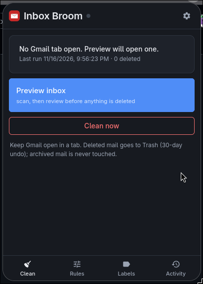
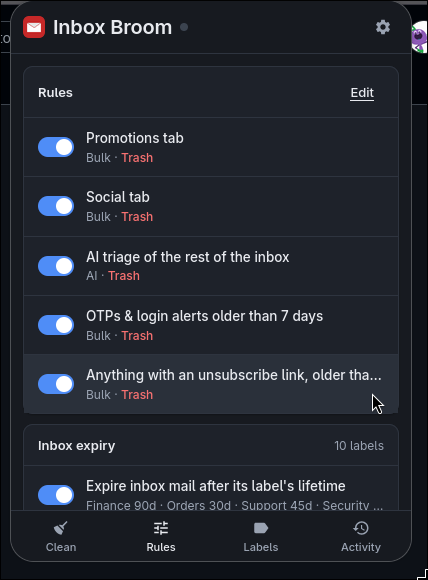
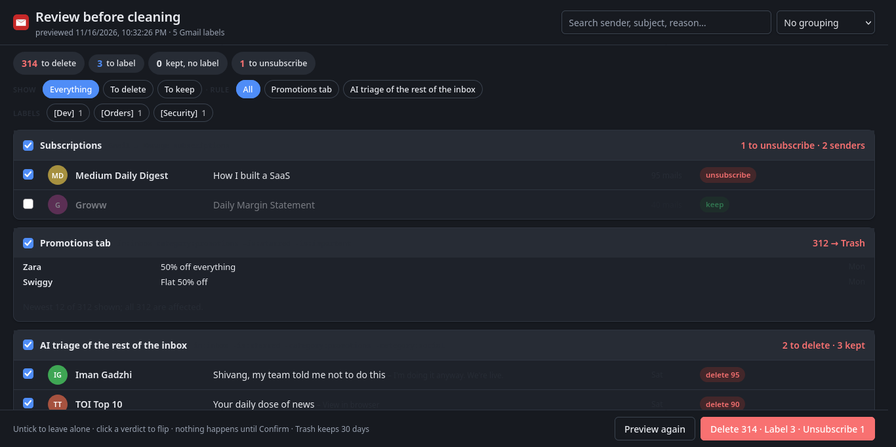
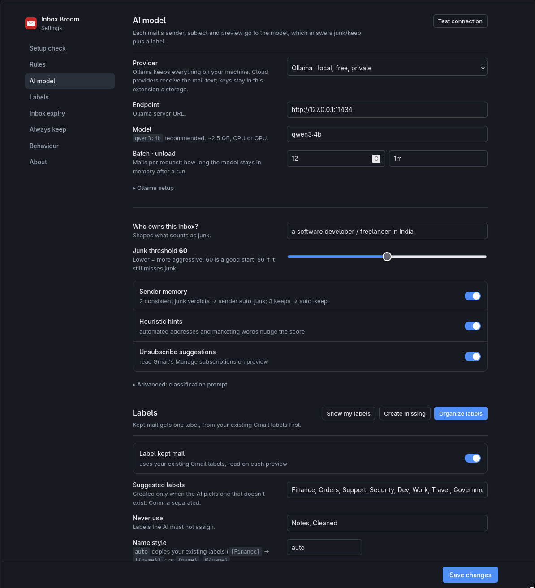

# Inbox Broom

**Sweep junk out of Gmail, from Firefox or Chrome, with a local AI. No API keys, nothing leaves your machine.**

<p align="center">
  
  
</p>
<p align="center">
  
</p>
<p align="center">
  
</p>

Inbox Broom is a browser extension (Firefox, Chrome, Edge, Brave) that cleans junk out of your Gmail inbox by **driving the Gmail web page the way you would by hand**.
No Google API, no OAuth client, no cloud: it runs searches, ticks rows, clicks Archive / Delete / Label / Unsubscribe.
Optional **local AI** (Ollama) decides what is junk, labels what you keep, and suggests subscriptions to drop.

```
Preview  →  review page (edit verdicts, labels, subscriptions)  →  Confirm
```

Nothing is ever permanently deleted: junk goes to Trash (30-day undo), kept mail stays in the inbox with a label, and any run can be undone in one click for 7 days.

## What it does

| Feature | How |
|---|---|
| **Bulk rules** | A Gmail search per rule (`category:promotions -is:starred`). Everything matching is selected via *"Select all N conversations"* and trashed in one shot, thousands at a time. |
| **AI triage** | For the rest of the inbox: sender + subject + preview of each row go to a local Ollama model, which returns *junk / keep* with a confidence and a reason. Only junk rows are ticked and trashed. |
| **Labels** | Every kept mail gets one label, chosen from **your existing Gmail labels** first, then a fallback set (Finance, Orders, Support, Security, Dev, Work, Travel, Government, Personal) created on first use. Uses Gmail's *Label as* menu. |
| **Retention** | The inbox is a queue, the archive is forever. Each label has an inbox lifetime (Security 7 d, Orders/Dev 30 d, Support 45 d, Work/Personal 60 d, Finance/Government 90 d, Travel 120 d) plus a catch-all for unlabeled inbox mail (90 d). Expired mail is trashed on the next run, after appearing in the preview. Archived, starred and important mail is never touched: archive anything you want to keep. |
| **Unsubscribe** | Reads Gmail's *Manage subscriptions* page and scores each sender on how many of their mails you actually opened (tracked from rows the scans already see), how triage treated them, and volume. The AI decides with those signals; never-opened, always-junk senders are suggested even if it hesitates, senders you usually open never are, and without a model the score alone decides. If that page (sidebar → More) can't be read: candidates are bulk senders the scans saw at least twice, and Confirm opens each one's latest mail and clicks the Unsubscribe link Gmail shows next to the sender (never a link inside the mail). Confirm clicks Gmail's own Unsubscribe. Banks, brokers, shops, hosting, GitHub, telecom, government are never pre-selected. |
| **Label tools** | *Organize labels* creates the taxonomy labels in Gmail, renames them to match your existing style (`[Finance]` → `[Orders]`, auto-detected or set), colors them and pins the important ones in the sidebar (show / show-if-unread / hide), all through Gmail's own dialogs. |
| **Review page** | Full-tab table: filter, group by sender, flip verdicts, change labels, "always delete / always keep" per sender, tick/untick anything, then one Confirm button with exact counts. |
| **Undo** | Popup → Activity → *Undo* on any run from the last 7 days. Each run tags what it trashes or archives with a temporary label (`Broom undo 261118-183827`); Undo moves exactly those back to the Inbox, takes the run's AI labels off again, and deletes the tag. Restored mail gets a `Broom restored` label that every rule skips, so the next run doesn't trash it again. Tags of runs you don't undo are deleted after 7 days. Unsubscribes can't be undone. |
| **Memory** | Verdicts cached per thread; after 2 consistent junk verdicts a sender is auto-junk with no model call. Your overrides win. Exportable AI log for tuning. |
| **Safety** | Every rule is inbox-only (`in:inbox` forced) unless you opt out, so archived or labeled mail is never swept up by a delete rule. Stop button in-page. English Gmail UI selectors fail safe with a diagnostic message, nothing is clicked blind. |

## Install

### Quick (temporary, gone on restart)

1. Download `inboxbroom.xpi` from [Releases](../../releases) or clone this repo.
2. Firefox → `about:debugging` → **This Firefox** → **Load Temporary Add-on…** → pick the `.xpi` (or `manifest.json` from the clone).

### Permanent

Firefox release builds only install signed add-ons. Options:

- **Firefox Developer Edition / Nightly / ESR**: `about:config` → `xpinstall.signatures.required = false`, then
  `about:addons` → gear → *Install Add-on From File* → the `.xpi`.
- **Any Firefox, self-signed (free, 2 min)**: get AMO API keys at <https://addons.mozilla.org/developers/addon/api/key/>, then
  ```sh
  npm install
  npm run sign -- --api-key "$AMO_JWT_ISSUER" --api-secret "$AMO_JWT_SECRET"
  ```
  Install the signed `.xpi` from `web-ext-artifacts/`. Change the id in `manifest.json` (`browser_specific_settings.gecko.id`) to something of your own first, AMO ids are unique per account.

## AI provider (optional but recommended)

Without a model only bulk rules run. With one you get triage, labels and unsubscribe suggestions. Pick one in **Settings → Local AI → Provider**:

| Provider | What leaves your machine | Cost | Notes |
|---|---|---|---|
| **Ollama** (default) | nothing | free | best privacy; needs ~2.5 GB model, runs on CPU or GPU |
| **OpenAI-compatible** | sender, subject, ~200 chars of preview per mail | per token | works with OpenAI, OpenRouter, Groq, Mistral, Gemini (OpenAI compat endpoint), LM Studio, vLLM… set base URL + key + model |
| **Anthropic** | same | per token | `claude-opus-5-5` default (low effort), `claude-haiku-5-5` for cheap bulk triage |

API keys are stored only in the extension's local storage. Firefox asks once for permission to contact the provider's host and to send it mail data (*personal communications*); nothing goes to a cloud provider until you allow both. See [PRIVACY.md](PRIVACY.md).

### Ollama

```sh
# 1. Install Ollama  https://ollama.com
# 2. Pull a model (4B is plenty for this; ~2.5 GB, runs on CPU or any GPU)
ollama pull qwen3:4b
# 3. Allow Firefox extensions to call it
OLLAMA_ORIGINS="moz-extension://*,chrome-extension://*" ollama serve
```

Running Ollama as a service instead? Add `Environment="OLLAMA_ORIGINS=moz-extension://*,chrome-extension://*"` via `sudo systemctl edit ollama` and restart it.
On **Linux with systemd** you can also install the on-demand units in [`contrib/ollama-on-demand`](contrib/ollama-on-demand):
Ollama starts on the first request and shuts down a few minutes after the last, so nothing idles in RAM/VRAM.

Then: extension **Settings → Local AI → Test connection**.

Model notes (tested on a 30-mail set drawn from a real inbox):

| Model | Result |
|---|---|
| `qwen3:4b` (default) | 49/49 verdicts, sensible labels, ~0.5 s per mail on an RTX 3070 |
| `gemma3:4b`, `llama3.2:3b` | fine, slightly less accurate |
| `qwen3:8b` | if you have ≥ 8 GB VRAM and want extra margin |

Set **"Who owns this inbox?"** in Settings (e.g. *a nurse in Berlin*). It is injected into the prompt and changes what counts as junk.
The whole system prompt is editable.

## Usage

1. Open Gmail in a tab (any account; whichever `/u/N/` is open is used). Keep the UI in English.
2. Toolbar icon → toggle rules → **Preview**. Watch the Gmail tab; it navigates on its own. Don't click around in it meanwhile.
3. The review tab opens. Check the *Subscriptions* block, the AI table (badge = verdict + score, hover for reason), labels, bulk counts.
4. **Confirm**. Progress streams into the page and the Gmail banner. Stop any time.

**Clean now** in the popup skips the review and runs everything with current verdicts.
**Auto-clean** (Settings) runs on a timer if a Gmail tab is open.

## Default rules

| Rule | Query | Action |
|---|---|---|
| Promotions tab | `category:promotions -is:starred -is:important` | Trash |
| Social tab | `category:social -is:starred -is:important` | Trash |
| AI triage of the rest | `in:inbox -is:starred -is:important -category:promotions -category:social` minus already-labeled mail | Trash junk, label kept |
| OTPs & login alerts > 7 d | `older_than:7d subject:(otp OR "verification code" OR "security alert" OR "new sign-in" …)` | Trash |
| Unsubscribe-able > 30 d (off) | `unsubscribe older_than:30d -is:starred -is:important` | Trash |
| Retention | `in:inbox label:<X> older_than:<N>d -is:starred -is:important` per label, plus `in:inbox older_than:90d` minus those labels | Trash |

All editable in Settings. Rules are plain [Gmail search](https://support.google.com/mail/answer/7190).

## How it works / limitations

- Content script on `mail.google.com`. Navigation by `#search/<query>`; selection via the toolbar checkbox and Gmail's
  *Select all N conversations* link; actions via `div[act="7"]` (archive), `div[act="10"]` (delete), the *Labels* menu,
  *Move to* menu, and the *Manage subscriptions* page. Selectors prefer language-independent attributes, then English
  tooltips, then geometry. If Gmail changes something, the run stops with `… not found. diag: …`, open an issue with that line.
- English Gmail UI only for now (strings live at the top of `content.js`).
- Row data only: sender, subject, ~200 chars of preview. Nothing leaves your machine except calls to `127.0.0.1:11434`.
- Not affiliated with Google. Use at your own risk; preview before you confirm.

## Development

```sh
npm install
npm run lint     # web-ext lint (Firefox manifest)
npm run run      # launches Firefox with the extension loaded
npm run build    # -> dist/inboxbroom-firefox.xpi, dist/inboxbroom-chrome.zip, dist/chrome/ (Load unpacked)
```

```
manifest.json         Firefox (MV2)        manifest.chrome.json   Chromium (MV3)
background.js         settings, rules, AI calls, sender memory, retention, review-tab plumbing
background.sw.js      MV3 service-worker entry (imports lib/compat.js + background.js)
lib/compat.js         Firefox/Chromium shim: browser global, async messaging, action API
content.js            drives Gmail: search / select / archive / delete / label / unsubscribe
content.css           in-page progress banner
popup/ review/ options/ ui/   UI pages and the shared design kit
contrib/              Ollama on-demand systemd units
scripts/build.sh      builds both packages
.github/workflows     lint + build on push, release on v* tags
```

Chromium notes: the background is a service worker, so long runs live in the Gmail tab and report back through storage; the content script pings the worker every 20 s while working. Ollama must allow `chrome-extension://*` origins (see above).

## License

MIT
